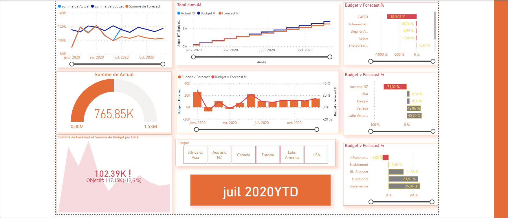

# Financial Performance Dashboard

**Actuals, budget and forecasts — a Power BI project by Mohammed Bahari.**

Compare financial performance over time and explore differences across regions, departments and cost elements.

**Power BI · Power Query · DAX · Financial Analysis · Star Schema**

[Explore the report](powerbi-financial-dashboard/powerbi-financial-dashboard.pbix) · [Browse project files](powerbi-financial-dashboard/) · [My portfolio](https://github.com/BAHARI111/Portfolio)

## Dashboard preview

*Static preview. Download the Power BI report to explore its interactive features.*

## Business questions

- How do actual results compare with budget and forecast?
- How does performance evolve over time?
- Which regions, departments and cost elements account for the differences?

## Project approach

| Stage | Work covered |
| --- | --- |
| Prepare | Load, clean and validate data; correct data types and categories with Power Query |
| Model | Connect fact and dimension tables using a star schema |
| Calculate | Build DAX totals for Actual, Budget and Forecast, cumulative measures and comparisons |
| Explore | Combine KPI indicators, trend charts and time-based filters |

The documented model includes a calendar, regions, departments and cost elements to support analysis at different levels.

## Explore locally

1. Download the repository using **Code → Download ZIP**, then extract it.
2. Open [powerbi-financial-dashboard.pbix](powerbi-financial-dashboard/powerbi-financial-dashboard.pbix) in Microsoft Power BI Desktop.
3. Use the report filters to explore periods and business dimensions.
4. Before refreshing, check the report's data-source paths and update them to your local files if needed.

**Data availability:** this repository includes Budget and Forecast CSV files and a dimension workbook. A separate Actuals source file is not included, so a complete refresh may require that additional source. Viewing the report and refreshing its source data are separate steps.

## Repository contents

| File | Purpose |
| --- | --- |
| [Power BI report](powerbi-financial-dashboard/powerbi-financial-dashboard.pbix) | Report and model |
| [Budget.csv](powerbi-financial-dashboard/Budget.csv) | Budget data |
| [Forecast.csv](powerbi-financial-dashboard/Forecast.csv) | Forecast data |
| [dim_tables.xlsx](powerbi-financial-dashboard/dim_tables.xlsx) | Dimension workbook |
| [dashboard.png](powerbi-financial-dashboard/dashboard.png) | Dashboard screenshot |

## Skills demonstrated

Power Query data preparation, relational modeling, DAX calculations, cumulative analysis, financial reporting and interactive dashboard design.

Key learning challenges included building correct table relationships, understanding running totals and organizing a clear report layout.

## Author & related work

**Mohammed Bahari** · [GitHub](https://github.com/BAHARI111) · [Portfolio](https://github.com/BAHARI111/Portfolio)

Also explore my [Sales Dashboard](https://github.com/BAHARI111/Sales-Dashboard-Power-BI).

See [LICENSE](LICENSE) for the repository's license terms.
